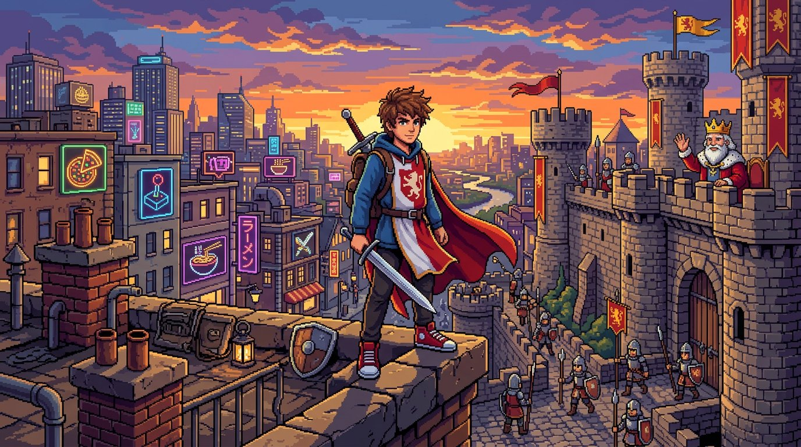
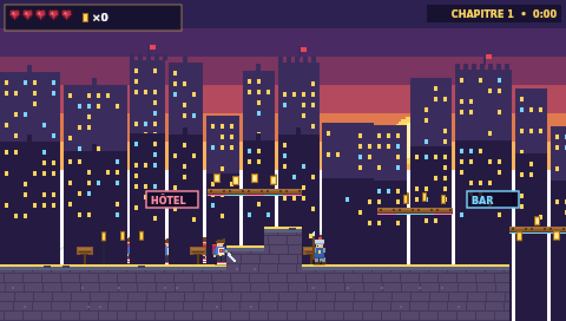
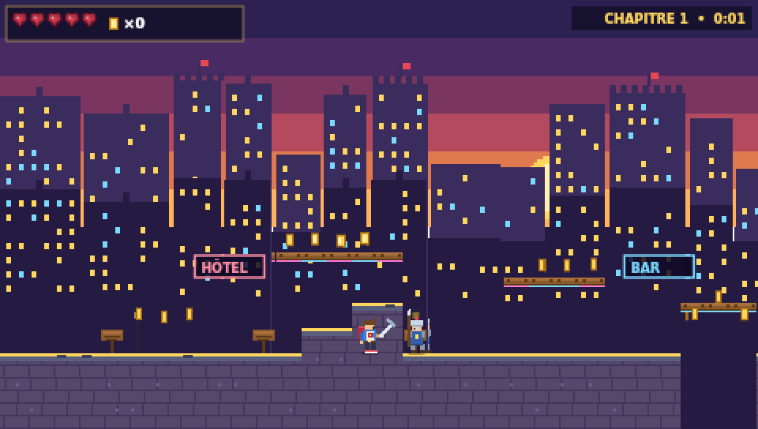
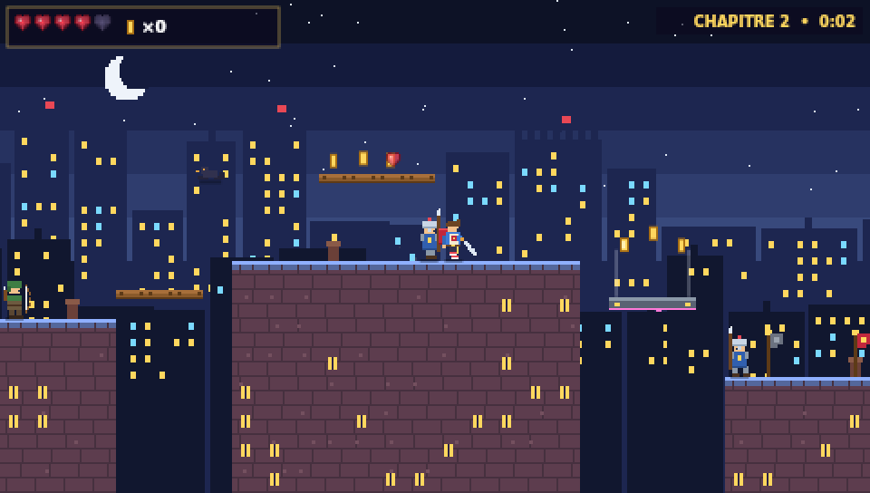
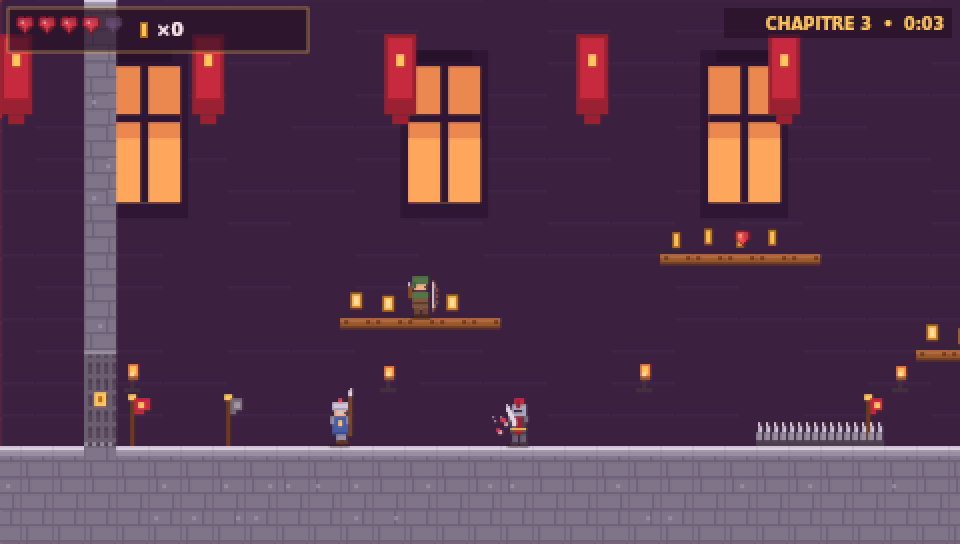
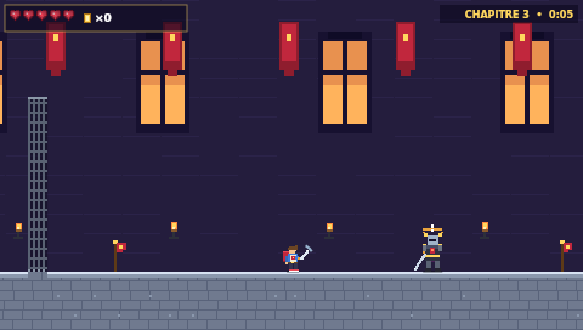
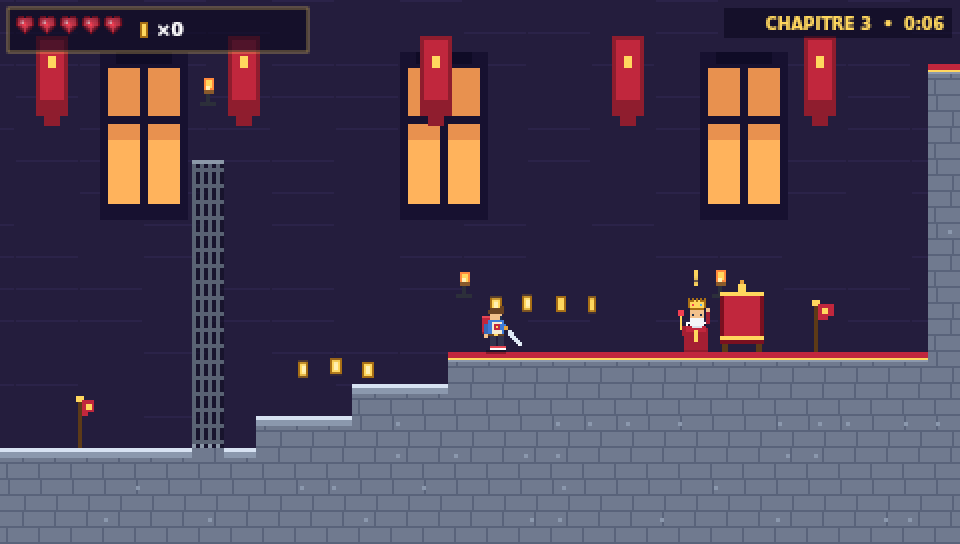

# ⚔️ ÉPÉE & NÉONS — Le Dernier Écuyer

**Un jeu de plateforme en pixel art, à l'époque moderne... mais sans aucune arme avancée !**



## 👑 L'histoire

An de grâce **2026**, royaume de **Valnéon**. Les immeubles ont des néons, les cafés servent des pizzas...
mais par le **décret royal n°42**, les armes à feu sont **interdites** : tout se règle encore à l'**épée**, à la **lance** et à l'**arc**, sous l'œil des **gardes royaux** et du vieux **roi Aldéric III**.

Le **Capitaine Corvus** et ses gardes renégats ont volé la **Couronne d'Or** !
Toi, **Léo**, écuyer livreur en hoodie et baskets rouges, tu es le dernier espoir du royaume.

## 🗺️ Les 3 chapitres

| # | Chapitre | Ambiance |
|---|----------|----------|
| 1 | **Les Rues de Valnéon** | Coucher de soleil, néons, échafaudages, premiers gardes |
| 2 | **Toits & Remparts** | Nuit étoilée, sauts entre toits, plateforme mobiles, corbeaux |
| 3 | **Le Château du Roi** | Grande salle, gardes d'élite... et le **boss** : ☠️ **Capitaine Corvus** |

## 📸 Captures d'écran

| La ville moderne au couchant | Combat contre un garde royal |
|---|---|
|  |  |

| Les toits la nuit | Le château |
|---|---|
|  |  |

| ☠️ Boss : Capitaine Corvus | Le trône du roi Aldéric III |
|---|---|
|  |  |

## 🎮 Comment jouer

Ouvre simplement **`index.html`** dans un navigateur — ou lance un petit serveur :

```bash
python3 -m http.server 8000
# puis ouvre http://localhost:8000
```

### Contrôles

| Touches | Action |
|---|---|
| `←` `→` ou `Q` `D` (AZERTY) / `A` `D` | Courir |
| `Espace` / `Z` / `↑` | Sauter — **deux fois = double saut** |
| `J` / `X` / `F` | Attaquer à l'épée ⚔️ |
| `K` / `Maj` | Dash (esquive éclair, traverse les coups) |
| `P` / `Échap` | Pause |
| `M` | Son on/off |
| 📱 Mobile | Boutons tactiles à l'écran |

### Astuces d'écuyer

- 🛡️ Les **gardes d'élite** bloquent tes coups de face avec leur bouclier : frappe-les **dans le dos**, **en sautant par-dessus**, ou **pendant leur attaque**.
- 🏹 Tu peux **trancher les flèches** des archers en plein vol.
- 🗝️ Les **herses royales** exigent une clé, souvent gardée en hauteur.
- 🚩 Les **bannières** sont des points de retour si tu tombes.
- ☠️ Contre **Corvus** : esquive sa charge pour qu'il s'écrase contre un mur, saute par-dessus ses ondes de choc, et frappe quand il chancelle !

## 🛠️ Technique

- **100 % web** : HTML + CSS + JavaScript vanilla, zéro dépendance, aucun asset externe.
- Moteur canvas maison en résolution interne **480×272** (pixel art net, agrandi en CSS).
- Tous les **sprites sont dessinés en code**, pixel par pixel (`js/sprites.js`).
- **Musique et sons 8-bit synthétisés** en WebAudio (`js/audio.js`) — mélodie médiévale en mode dorien !
- Niveaux définis en données (`js/levels.js`), sauvegarde de progression et meilleur score en `localStorage`.

### Tests

Un test headless simule une partie complète (course, combats, clés, herses, boss, victoire) :

```bash
node tests/simulate.js
```

## 📁 Structure

```
index.html            → écrans (titre, pause, victoire...) et HUD
css/style.css         → habillage "borne d'arcade"
js/game.js            → moteur : physique, IA, combats, boss, rendu
js/sprites.js         → personnages & objets en pixel art procédural
js/levels.js          → les 3 chapitres
js/audio.js           → musique chiptune + bruitages WebAudio
assets/keyart.jpg     → affiche du jeu
assets/screenshots/   → captures
tests/simulate.js     → test de partie automatisé
```

---

*Par décret royal n°42 : les armes à feu sont interdites dans tout le royaume. 🚫🔫 Vive le Roi, vive l'épée !*
